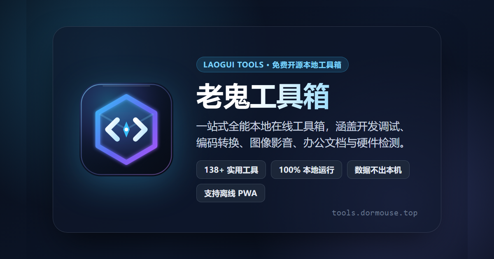
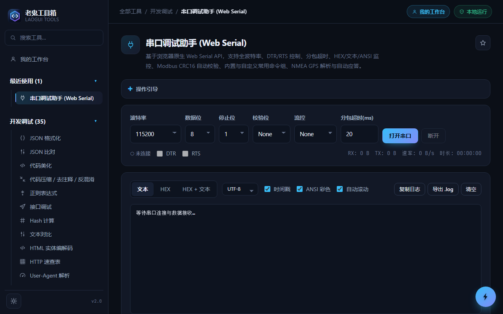
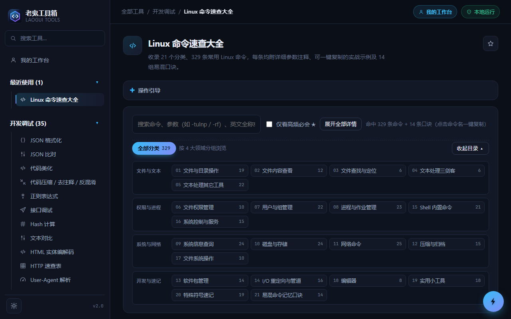

  

<h1 align="center">老鬼工具箱 · Laogui Tools</h1>

  <b>一站式全能纯本地在线工具箱（138+ 免费实用工具）</b> 
  100% 浏览器本地运行 · 零数据上传 · 无广告免登录 · 支持离线 PWA

  
  
  
  

---

## ✨ 为什么做「老鬼工具箱」？

日常开发、办公与硬件排查时，经常要在十几个广告弹窗满天飞的网站之间切换，更让人担心的是：**接口 JSON、合同 PDF、数据库 `.db`、密钥与日志上传到第三方服务器极不安全**。

**老鬼工具箱**将 138+ 高频实用工具整合在一个清爽的纯静态 PWA 应用中：
- 🔒 **数据不出本机**：全部解析、压缩、加解密、PDF 与 WASM 运算均在浏览器本地完成；
- ⚡ **按需懒加载 + 离线可用**：打开即用，安装为桌面 PWA 后断网也能照常工作；
- 🎨 **高度可定制工作台**：内置 9 套主题（含柔光玻璃、液态玻璃）、自定义首页场景分组，以及端到端 AES-256-GCM 加密多设备配置同步。

> 👉 **立即体验**：[https://tools.dormouse.top](https://tools.dormouse.top)

---

## 📸 界面预览

| 首页与场景分组 | 手绘无限画布白板（RoughJS） |
| :---: | :---: |
|  |  |

| Web Serial 浏览器串口调试助手 | Linux 329 条命令速查大全 |
| :---: | :---: |
|  |  |

---

## 🧰 六大分类与核心工具直达

### 1. 💻 [开发调试工具大全](https://tools.dormouse.top/category/code)
- [JSON 格式化与校验](https://tools.dormouse.top/tool/json-format) / [JSON Diff 对比](https://tools.dormouse.top/tool/json-diff) / [JSONPath 与截断修复](https://tools.dormouse.top/tool/jsonpath-repair)
- [正则表达式测试（多语言代码 + SVG 铁路图）](https://tools.dormouse.top/tool/regexp)
- [Web Serial 在线串口调试助手（AT / Modbus CRC16 / GPS）](https://tools.dormouse.top/tool/serial-debug)
- [SQLite (WASM) 本地数据库查询](https://tools.dormouse.top/tool/sqlite) / [SQL 格式化](https://tools.dormouse.top/tool/sql-format) / [MyBatis 日志还原 SQL](https://tools.dormouse.top/tool/sql-mybatis)
- [Linux 命令速查大全（329 条含参数详解与示例）](https://tools.dormouse.top/tool/linux-cmd)
- [Cron 表达式解析](https://tools.dormouse.top/tool/crontab) / [JWT 本地解析与验签](https://tools.dormouse.top/tool/jwt-parse)

### 2. 🔄 [编码与配置转换工具大全](https://tools.dormouse.top/category/convert)
- [时间戳转换（秒/毫秒/微秒/纳秒 + 时区 + 批量互转）](https://tools.dormouse.top/tool/timestamp)
- [配置格式互转（.env / INI / TOML / YAML / JSON / CSV→SQL）](https://tools.dormouse.top/tool/config-convert)
- [URL / Base64 / Unicode / HTML 编解码](https://tools.dormouse.top/tool/en-decode)
- [颜色转换（HEX / RGB / HSL）](https://tools.dormouse.top/tool/trans-color) / [进制转换](https://tools.dormouse.top/tool/trans-radix)

### 3. 🎨 [图像、文档与可视化工具大全](https://tools.dormouse.top/category/media)
- [手绘白板 / 无限画布（RoughJS + 锚点连线 + PNG/SVG 导出）](https://tools.dormouse.top/tool/whiteboard)
- [在线思维导图（XMind 快捷键 + Markdown 双向大纲）](https://tools.dormouse.top/tool/naotu)
- [本地 PDF 工具箱（合并 / 拆分 / 转图片 / 扫描件效果）](https://tools.dormouse.top/tool/pdf-tools)
- [二维码生成与本地解码](https://tools.dormouse.top/tool/qr-code) / [图片转 Base64](https://tools.dormouse.top/tool/image-base64)

### 4. ⚡ [效率办公工具大全](https://tools.dormouse.top/category/eff)
- [文档本地转 Markdown（.docx / .xlsx / .pdf / .html）](https://tools.dormouse.top/tool/doc2md)
- [Markdown 实时预览](https://tools.dormouse.top/tool/markdown) / [文本对比（LCS）](https://tools.dormouse.top/tool/text-diff) / [Excel 转 JSON](https://tools.dormouse.top/tool/excel2json)

### 5. 🧮 [计算与生成工具大全](https://tools.dormouse.top/category/calc)
- [随机强密码生成与强度检测](https://tools.dormouse.top/tool/password) / [UUID v4/v7 & ULID 生成](https://tools.dormouse.top/tool/uuid)
- [MD5 / SHA / HMAC 哈希校验](https://tools.dormouse.top/tool/hash) / [全规格 CRC-8/16/24/32/64](https://tools.dormouse.top/tool/crc-base58)
- [数理统计与图表](https://tools.dormouse.top/tool/stats-calc) / [财务复利 / 个税 / 房贷计算](https://tools.dormouse.top/tool/finance-calc)

### 6. 🔧 [硬件检测与其他实用工具](https://tools.dormouse.top/category/more)
- [音视频与外设检测（麦克风 / 左右声道 / 摄像头 / 手柄）](https://tools.dormouse.top/tool/av-hw-test)
- [CPU / GPU 浏览器性能压测](https://tools.dormouse.top/tool/perf-bench) / [IPv4 & CIDR 子网计算](https://tools.dormouse.top/tool/cidr)

---

## 💬 反馈与新工具许愿

- 直接在 [https://tools.dormouse.top](https://tools.dormouse.top) 点击右下角悬浮球 → **意见反馈 / 留言**；
- 或在本仓库提交 Issue，说明你希望新增的实用工具或改进建议。

如果觉得好用，欢迎点一个 ⭐ **Star** 支持！
